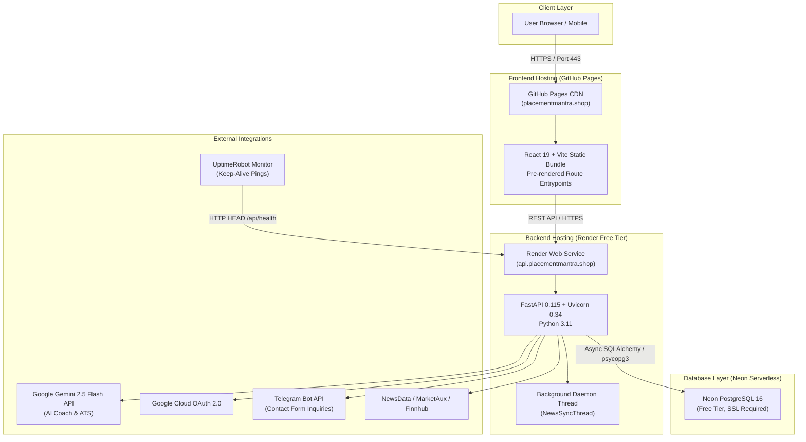
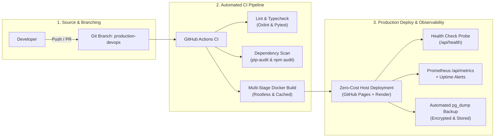

# Production Audit Report: Placement Mantra

**Project:** Placement Mantra (Placement Prep Portal)  
**Live URL:** [https://placementmantra.shop](https://placementmantra.shop)  
**API URL:** [https://api.placementmantra.shop](https://api.placementmantra.shop)  
**Date:** November 19, 2026  
**Auditor:** Senior DevOps & Cloud Architecture Specialist  
**Target Branch:** `production-devops`  
**Infrastructure Budget:** ₹0 / month (Strict Free-Tier Policy)

---

## Executive Summary

Placement Mantra is an end-to-end placement preparation ecosystem tailored for MBA and management students (specifically aligned with Great Lakes Institute of Management). The platform provides aptitude training, management domain modules (Consulting, Finance, Marketing, Operations, Analytics), company hiring patterns and question banks, timed mock assessments, AI career coaching (resume ATS grading, interview simulations), and peer networking.

This audit evaluates the entire system architecture across 10 core dimensions to establish a baseline for containerization, production hardening, CI/CD pipeline implementation, monitoring, and automated database backups—while strictly preserving all existing features, maintaining zero cloud spend, and avoiding downtime.

---

## 1. High-Level Current Architecture



---

## 2. Detailed Dimension Audit

### A. Frontend Architecture

| Attribute | Specification | Notes / Observations |
| :--- | :--- | :--- |
| **Framework** | React 19.2.8 (`react`, `react-dom`) | Modern concurrent mode support. |
| **Build Tooling** | Vite 8.2.0 + `@vitejs/plugin-react` 6.0.4 | Ultra-fast HMR and Rollup/Rolldown bundler. |
| **Styling** | Tailwind CSS v4 (`@tailwindcss/vite` 4.3.3) | Single-pass CSS engine with minimal runtime. |
| **Routing** | `react-router-dom` 7.18.2 | Client-side routing with `createBrowserRouter`. |
| **Static Pre-rendering** | Custom `scripts/generate-routes.js` | Generates physical HTML route files (`about/index.html`, etc.) so GitHub Pages serves HTTP 200 OK to search engine crawlers. |
| **State & API Client** | Custom fetch wrapper in `src/lib/api.ts` | LocalStorage token persistence (`token`, `user`), custom `auth-change` event dispatching. |
| **Document/Media Tools** | `pdfjs-dist` 6.3.289, `lucide-react` 1.38.0 | In-browser PDF resume viewing and icons. |
| **Markdown Rendering** | `react-markdown` 10.1.0, `remark-gfm` 4.0.1 | Renders test explanations and study guides. |

**Key Findings:**
- The frontend bundle contains a large JS chunk (`1,138 kB`) exceeding Vite's 500 kB chunk threshold. Route-based code splitting (`React.lazy`) should be introduced to improve mobile load times.
- Static route pre-rendering is functioning properly for search bots and deep linking on GitHub Pages.

---

### B. Backend Architecture

| Attribute | Specification | Notes / Observations |
| :--- | :--- | :--- |
| **Framework** | FastAPI 0.115.6 + Starlette | Asynchronous ASGI REST API framework. |
| **Server Engine** | Uvicorn 0.34.0 | ASGI standard worker server. |
| **Python Runtime** | Python 3.11.9 | Pinned to prevent dependency incompatibilities with 3.13. |
| **ORM & Database** | SQLAlchemy 2.0.36 + `psycopg[binary]` 3.2.3 | Declarative 2.0 style ORM with PostgreSQL binary driver. |
| **Schema Validation** | Pydantic 2.13.5 + `pydantic-settings` 2.7.0 | Strict request/response typing. |
| **Migrations** | Alembic 1.14.0 | Linear schema versioning with 21 tracked revisions. |
| **Background Tasks** | In-process daemon thread (`NewsSyncThread`) | Runs every 30 minutes in `main.py` + GitHub Actions fallback. |
| **File Storage** | `app.core.storage.StorageProvider` | Pluggable interface: `LocalStorageProvider` and `S3StorageProvider`. |

**Key Findings:**
- In-process background thread executes inside Render's single worker. On memory-constrained free containers (512 MB RAM), background tasks must remain lightweight.
- Pydantic models contain legacy `class Config:` blocks instead of Pydantic V2 `ConfigDict`.

---

### C. Database Schema and Connections

- **Database Engine:** Managed PostgreSQL 16 hosted on **Neon** (`neon.tech`).
- **Connection Configuration:**
  - Connection pooling with `pool_pre_ping=True` to detect dropped connections across serverless idle states.
  - Connection recycling set to `pool_recycle=300` (5 minutes) to avoid stale socket exceptions.
  - Connection URL dynamically normalizes legacy `postgres://` prefixes to `postgresql+psycopg://`.
- **Primary Relational Tables:**
  - `users`: Authentication, Google OAuth identity, email, hashed credentials, OTP reset codes, admin flags.
  - `subjects`, `topics`, `topic_contents`, `solved_examples`: Curated placement preparation knowledge base.
  - `questions`, `tests`, `test_questions`, `test_attempts`: Assessment engine with answer hiding prior to submission.
  - `companies`, `job_descriptions`, `interview_questions`: Institutional placement tracking and JD repository.
  - `resumes`, `educations`, `experiences`, `projects`, `skills`, `skill_endorsements`: Student profile ecosystem.
  - `connections`, `messages`: Peer networking and direct communication.
  - `news_articles`: Curated business and industry news with sentiment scores.
  - `notifications`: User alert feed.
- **Migration State:** Current schema is aligned with Alembic revision `5978cd38df1c`. `fix_db.py` handles repair of any legacy version branching.

---

### D. API Endpoints

The API surface comprises 15 modular routers mounted in `app/main.py`:

```
/api/health               -> [GET, HEAD] Liveness & readiness probes
/api/auth/*               -> Login, register, Google OAuth, password reset OTP, profile refresh
/api/learning/*           -> Subjects, topics, topic detail, theory, solved examples
/api/practice/*           -> Mock tests, test creation, submission, score evaluation, attempt history
/api/companies/*          -> Company profiles, job descriptions, interview intelligence
/api/progress/*           -> Student progress metrics, accuracy stats, streak tracking
/api/guides/*             -> Placement and interview preparation guides
/api/projects/*           -> Student portfolio project tracking
/api/ai/*                 -> Gemini-powered ATS resume evaluator, interview bot, AI coach
/api/admin/*              -> User administration, content authoring, question banks
/api/connections/*        -> Peer connection requests, accepts, student directory
/api/profile/*            -> Resumes (upload/download), skills, experiences, education
/api/home/*               -> Landing page aggregation, counters, contact form
/api/messages/*           -> Peer-to-peer messaging
/api/news/*               -> Business news feed, search, category filtering, manual refresh
/api/notifications/*      -> Real-time notification polling and status marking
```

---

### E. Authentication and Authorisation

1. **Token Standard:** JSON Web Tokens (JWT) signed via HMAC-SHA256 (`HS256`).
   - Default expiration: 24 hours (`1440 minutes`).
   - Payload subject: User email address (`sub`).
2. **Password Security:** Salted hashing with `bcrypt` (work factor 12) via `passlib`.
3. **Domain Gatekeeper:** Registration is restricted to authorized institute domains (`greatlakes.edu.in`) via `ALLOWED_EMAIL_DOMAINS` to protect confidential campus recruitment intelligence.
4. **Role-Based Access Control (RBAC):**
   - User-level vs. Admin-level permissions (`is_admin` boolean flag).
   - Route protection via `get_current_user` and `get_current_admin` dependencies.
   - Dynamic promotion via `ADMIN_EMAILS` bootstrap environment variable.
5. **Data Isolation:** Practice assessment answers and explanations are stripped server-side until test finalization, preventing client tampering or inspecting network payloads for answer keys.

---

### F. Existing Hosting Infrastructure

| Component | Provider | Tier | Monthly Cost | Constraints / Characteristics |
| :--- | :--- | :--- | :--- | :--- |
| **Frontend** | GitHub Pages | Free | ₹0 | Static CDN, custom apex domain (`placementmantra.shop`), automated HTTPS certificate. |
| **Backend API** | Render | Free Web Service | ₹0 | 512 MB RAM, 0.1 CPU, auto-spins down after 15 min idle. Cold start latency: 45–60s. |
| **Database** | Neon.tech | Free Serverless Postgres | ₹0 | 0.5 GB storage, auto-suspends compute after 5 min. Data never auto-deleted. |
| **DNS Management** | GoDaddy / Cloudflare | Free | ₹0 | Standard A/CNAME routing. |
| **Uptime Monitoring** | UptimeRobot | Free | ₹0 | 5-minute HTTP HEAD keep-alive ping on `/api/health`. |
| **Total Monthly Spend** | | | **₹0.00** | Completely sustainable on free tiers. |

---

### G. Environment Variables Specification

The application consumes the following environment variables (defined in `backend/app/core/config.py` and `frontend/.env`):

#### Backend:
| Variable Name | Required | Purpose |
| :--- | :--- | :--- |
| `ENVIRONMENT` | Yes | Defines `production` vs `development`. |
| `SECRET_KEY` | Yes (in prod) | Cryptographic secret for signing JWTs. Default blocked in prod. |
| `DATABASE_URL` | Yes | Connection string to Neon PostgreSQL (`postgresql://...`). |
| `CORS_ORIGINS` | Yes | Comma-separated allowed frontend origins. |
| `ALLOWED_EMAIL_DOMAINS` | No | Restricts signups (e.g. `greatlakes.edu.in`). |
| `GOOGLE_CLIENT_ID` | Optional | Client ID for Google Identity Services. |
| `ADMIN_EMAILS` | Optional | Auto-promotes specified emails to admin. |
| `GEMINI_API_KEY` | Optional | Google Gemini 2.5 Flash API key for AI features. |
| `SMTP_SERVER` / `SMTP_PORT` | Optional | Mail server configuration for OTP password resets. |
| `SMTP_USERNAME` / `SMTP_PASSWORD`| Optional | Credentials for SMTP server. |
| `SMTP_FROM_EMAIL` | Optional | Outgoing sender email address. |
| `STORAGE_PROVIDER` | Optional | `local` (default) or `s3`. |
| `S3_BUCKET_NAME` / `S3_REGION_NAME`| Optional | S3 or Cloudflare R2 bucket settings. |
| `AWS_ACCESS_KEY_ID` / `AWS_SECRET_ACCESS_KEY` | Optional | Object storage credentials. |
| `TELEGRAM_BOT_TOKEN` / `TELEGRAM_CHAT_ID` | Optional | Forwards contact inquiries to administrator Telegram. |
| `NEWSDATA_API_KEY` / `MARKETAUX_API_KEY` / `FINNHUB_API_KEY` | Optional | Business news aggregation API keys. |
| `NEWS_REFRESH_MINUTES` | Optional | Frequency of background news sync (default 30). |

#### Frontend:
| Variable Name | Required | Purpose |
| :--- | :--- | :--- |
| `VITE_API_BASE_URL` | Yes | Base URL of the backend API (`https://api.placementmantra.shop`). |
| `VITE_GOOGLE_CLIENT_ID`| Optional | Client ID for `@react-oauth/google` sign-in button. |

---

### H. Existing Deployment Workflow

1. **Frontend Deployment (`.github/workflows/deploy.yml`):**
   - Trigger: Push to `main` branch.
   - Process: Node 20 environment -> `npm ci` -> `tsc --noEmit` -> `npm run build` (with `generate-routes.js`) -> `actions/deploy-pages@v4`.
   - Artifact: Static build uploaded directly to GitHub Pages CDN.
2. **Backend Deployment (Render Git Integration):**
   - Trigger: Webhook push to `main` branch.
   - Process: Render pulls repo -> runs `pip install -r requirements.txt` -> runs `startCommand`:
     `python fix_db.py && alembic upgrade head && python -m app.seed.seed && uvicorn app.main:app --host 0.0.0.0 --port $PORT`
   - Healthcheck: Render inspects `/api/health` before routing traffic.
3. **Scheduled News Refresh (`.github/workflows/refresh_news.yml`):**
   - Cron trigger every 30 minutes executing `POST /api/news/refresh`.

---

### I. Security Vulnerabilities and Risks

| Risk Level | Area | Finding | Impact | Mitigation Strategy |
| :--- | :--- | :--- | :--- | :--- |
| **HIGH** | Rate Limiting | No rate limiter on authentication endpoints (`/api/auth/login`, `/api/auth/register`, `/api/auth/forgot-password`). | Vulnerable to automated brute-force attacks and credential stuffing. | Implement SlowAPI / in-memory sliding window rate limiting. |
| **MEDIUM** | Security Headers | API responses lack modern defensive headers (`X-Content-Type-Options`, `X-Frame-Options`, `HSTS`, `Content-Security-Policy`). | Susceptible to clickjacking, MIME sniffing, and MITM downgrades. | Add a custom middleware injecting standard OWASP security headers. |
| **MEDIUM** | Container Security | Existing `Dockerfile` runs application processes as `root`. | Potential container breakout vulnerability if dependencies are compromised. | Introduce non-root user (`appuser:appgroup`) in Docker multi-stage build. |
| **MEDIUM** | Token Revocation | JWT tokens are stateless with 24-hour expiration and no revocation list. | Compromised token remains valid until expiry even after password change. | Add token versioning / short-lived tokens with refresh rotation. |
| **LOW** | Error Handling | Unhandled 500 exceptions could theoretically expose tracebacks in development mode. | Information disclosure to attackers. | Implement global FastAPI exception handler sanitizing 500 responses. |

---

### J. Performance Bottlenecks and Optimization Areas

1. **Render Free Tier Cold Starts:**
   - On Render free plan, containers hibernate after 15 minutes of zero traffic.
   - Waking up requires Python package initialization and database reconnection (~45 seconds).
   - *Mitigation:* Keep-alive HTTP HEAD pings every 10–14 minutes via UptimeRobot and GitHub Actions cron.
2. **Neon Serverless Compute Suspension:**
   - Neon suspends idle compute nodes after 5 minutes.
   - First query experiences a 1.5–2 second cold start delay.
   - *Mitigation:* Connection pool pre-pinging (`pool_pre_ping=True`) and recycling (`pool_recycle=300`) already prevent dropped connection errors.
3. **Frontend Bundle Size:**
   - Single JS chunk is 1.14 MB due to all feature routes being eagerly bundled.
   - *Mitigation:* Split admin, AI chat, and business news pages with `React.lazy()` and `Suspense`.
4. **Test Suite Execution Isolation:**
   - Integration tests share a single SQLite database file (`test.db`), causing concurrent test failures when executed together in one test runner session.
   - *Mitigation:* Configure unique in-memory SQLite fixtures (`sqlite:///:memory:`) per test session.

---

## 3. Recommended Phased DevOps Architecture



---

## 4. Next Steps & Approval Gates

All subsequent improvements will be implemented strictly on branch `production-devops` without disrupting the live production site:
- **Phase 2:** Production multi-stage Dockerfile and Docker Compose environment.
- **Phase 3:** Production server configuration and reverse proxy specifications.
- **Phase 4:** Application security hardening (Rate limiting, OWASP headers, error sanitizer).
- **Phase 5:** GitHub Actions production CI/CD workflows.
- **Phase 6:** Automated database backup scripts (`pg_dump`) and disaster recovery runbook.
- **Phase 7:** Prometheus metrics endpoint and observability setup.
- **Phase 8:** Performance tuning and integration verification.
